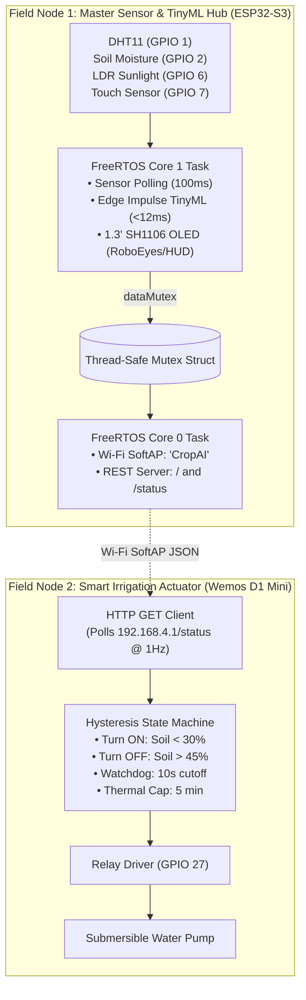

# 🌱 Nitroasis — AI & IoT-Based Smart Farming System

> 🌐 **Live Web Documentation & Interactive 3D STL Viewer:**  
> **[https://arunkannaa.github.io/Nitroasis/](https://arunkannaa.github.io/Nitroasis/)**

**Smart Monitoring | On-Device TinyML Crop Intelligence | Anti-Chatter Smart Irrigation | Off-Grid Solar Ready**

Nitroasis is an AI- and IoT-based autonomous precision agriculture system designed to help farmers monitor soil and microclimatic conditions, automate irrigation with zero cloud dependencies, receive real-time crop recommendations via embedded machine learning, and recycle aquaculture nutrients.

---

## 🚀 Interactive Web Portal & 3D CAD Viewer

The full system documentation, live interactive IoT hardware simulator, and interactive 3D CAD model inspector are deployed via GitHub Pages:

👉 **[Launch Nitroasis Web Portal](https://arunkannaa.github.io/Nitroasis/)**

### Web Portal Highlights:
- **3D CAD STL Viewer:** Directly orbit, zoom, pan, and inspect [`transmitter_top.stl`](transmitter_top.stl) and [`transmitter_bottom.stl`](transmitter_bottom.stl) with dimensions, polygon counts, and filament simulation.
- **Real-Time IoT Hardware Simulator:** Interactive sliders for soil moisture, temperature, humidity, and sunlight LDR to test on-device TinyML recommendations in real time.
- **Virtual 128×64 SH1106 OLED Display:** Emulates animated **RoboEyes** (blinking, gaze tracking, mood reactions) and **Sensor HUD** with a working capacitive touch button (GPIO 7).
- **Smart Irrigation Actuator Emulation:** Live animated water pump flow, hysteresis trigger points ($30\%\text{ ON} \to 45\%\text{ OFF}$), and fail-safe watchdog timer.
- **AI Agronomist (NitroBot):** Instant knowledge on NPK nutrient balancing, aquaponics recycling, and Indian agricultural subsidy schemes (PM-Kisan, PMKSY).

---

## ✨ Features

- 🌱 **Smart Biophysical Soil Sensing:** High-precision capacitive soil moisture sensing mapped via 12-bit ADC.
- ☀️ **Solar-Powered Off-Grid Design:** Engineered for remote field deployment with solar charge management and dual 18650 Li-ion storage.
- 🧠 **On-Device TinyML Crop Recommendations:** Edge Impulse neural model (`Akash501-project-1`) runs locally on the ESP32-S3 in $<12\,\text{ms}$.
- 💧 **Anti-Chatter Hysteresis Irrigation:** Dual-threshold relay logic ($30\%\text{ ON} \to 45\%\text{ OFF}$) preventing contact chatter and motor burnout.
- 🛡️ **Watchdog Fail-Safe Protection:** Automatically shuts off the pump if Wi-Fi telemetry is interrupted for $>10\,\text{s}$.
- 🔥 **Thermal Run Cap:** Mandatory 5-minute continuous run ceiling with a 30-second cooldown period.
- 📊 **Autonomous Wi-Fi Dashboard:** Built-in glassmorphic web dashboard hosted on the ESP32-S3 SoftAP (`CropAI` at `192.168.4.1`).
- 🌙 **LDR Day/Night Detection:** Automated photoperiod sensing via analog LDR thresholding.
- ♻️ **Closed-Loop Nutrient Recycling:** Explores converting nitrogen-rich aquaculture wastewater into sub-surface drip fertigation.
- 📦 **Rugged 3D CAD Enclosure:** Weatherproof, UV-resistant dual-shell enclosure files (`transmitter_top.stl` and `transmitter_bottom.stl`).

---

## 🏗️ System Architecture



---

## 🛠️ Hardware Components & Pinout

### Node 1: Master Sensor & TinyML Hub (`main.ino`)
- **Controller:** ESP32-S3 Dual-Core Xtensa LX7 @ 240MHz
- **DHT11 / DHT22:** `GPIO 1` (Digital 1-Wire)
- **Capacitive Soil Moisture Probe:** `GPIO 2` (ADC1_CH1)
- **1.3" SH1106 OLED SDA:** `GPIO 4` (I2C Data, `0x3C`)
- **1.3" SH1106 OLED SCL:** `GPIO 5` (I2C Clock, 400kHz)
- **LDR Light Sensor:** `GPIO 6` (ADC1_CH5)
- **Capacitive Touch Mode Switch:** `GPIO 7` (Touch Sense, threshold 25,000)

### Node 2: Irrigation Actuator Node (`reciver.ino`)
- **Controller:** Wemos D1 Mini / ESP32
- **Relay Module (IN):** `GPIO 27` (Optocoupled, Active HIGH/LOW configurable)
- **Flyback Diode:** 1N4007 (Inductive surge suppression)
- **Pump:** 5V–12V Submersible DC Water Pump

---

## 📁 Repository Structure

```
Nitroasis/
├── docs/                           # Deployed GitHub Pages documentation & Web Portal
│   ├── index.html                  # Main interactive portal
│   ├── style.css                   # High-contrast agro-cyber styles
│   ├── app.js                      # Simulator, TinyML, and OLED emulator engine
│   ├── stl_viewer.js               # Three.js 3D STL CAD viewer
│   ├── transmitter_top.stl         # 3D printable top cover
│   ├── transmitter_bottom.stl      # 3D printable chassis
│   ├── hardware.jpg                # Physical prototype photograph
│   └── lib/                        # Offline Three.js & loader scripts
├── .github/workflows/
│   └── deploy.yml                  # Automated GitHub Actions deployment workflow
├── main.ino                        # ESP32-S3 Dual-Core FreeRTOS master firmware
├── reciver.ino                     # Smart irrigation receiver & hysteresis firmware
├── transmitter_top.stl             # CAD 3D model (Top Enclosure, 20,874 triangles)
├── transmitter_bottom.stl          # CAD 3D model (Bottom Chassis, 9,076 triangles)
├── project img.jpg                 # Original prototype image
├── SUSTAINABLE SMART FARMING...mp4 # Video demonstration
└── README.md                       # Repository overview & manual
```

---

## 📐 3D CAD & Fabrication Specifications

- **Top Enclosure (`transmitter_top.stl`):** $90.0 \times 102.0 \times 21.5\,\text{mm}$ (20,874 polygons, $\sim 45.2\,\text{g}$).
- **Bottom Chassis (`transmitter_bottom.stl`):** $94.0 \times 102.0 \times 57.0\,\text{mm}$ (9,076 polygons, $\sim 148.5\,\text{g}$).
- **Total Assembled Dimensions:** $94.0 \times 102.0 \times 78.5\,\text{mm}$.
- **Recommended Filament:** **PETG or ASA** (resistant to outdoor UV degradation and temperatures up to 80°C).
- **Print Parameters:** $0.20\,\text{mm}$ layer height, 25% gyroid infill, 4 perimeter walls for waterproofness.

---

## 🔒 Security & Field Safety

- **Protected SoftAP:** Change the default `CropAI` AP password (`12345678`) before field deployment.
- **Fail-Safe Watchdog:** Always leave `LINK_TIMEOUT_MS` active so pump shuts off if master telemetry drops.
- **Inductive Snubbers:** Verify the flyback diode is installed across the pump terminals to protect the relay from back-EMF spikes.
- **Soil Probe Sealing:** Ensure the upper PCB section of capacitive soil sensors is coated with waterproof silicone or epoxy before burying.

---

## 🤝 Attribution & License

Copyright (c) 2026 Arun Hobbies. All rights reserved.

Created by **Arun Hobbies** ([ARUNKANNAA/Nitroasis](https://github.com/ARUNKANNAA/Nitroasis)).

Attribution is required whenever permitted portions of this project are referenced:
- Original creator: Arun Hobbies
- Project name: Nitroasis — AI & IoT-Based Smart Farming System
- Link: [https://github.com/ARUNKANNAA/Nitroasis](https://github.com/ARUNKANNAA/Nitroasis)
